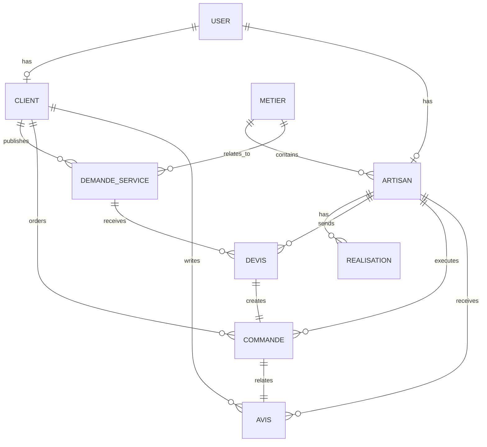

# ArtisanConnect Backend

ArtisanConnect est une API backend Django REST Framework destinée à mettre en relation des clients, des artisans et des administrateurs. Elle permet de rechercher des artisans, publier des demandes de service, négocier des devis, suivre des commandes et noter les prestations réalisées.

## 1. Présentation du projet

- Nom : ArtisanConnect
- Domaine : services et entrepreneuriat
- Objectif : aider les clients à trouver rapidement un artisan compétent, disponible et proche.
- Fonctionnalités principales :
  - authentification JWT
  - gestion des comptes client/artisan/admin
  - gestion des métiers
  - profils artisans et réalisations
  - demandes de service
  - devis et commandes
  - avis et notation
  - recherche multicritère
  - documentation API Swagger/OpenAPI

## 2. Stack technique

- Python 3.12+
- Django 6.1
- Django REST Framework 3.18
- SQLite (développement)
- djangorestframework-simplejwt
- django-filter
- Pillow
- django-cors-headers
- drf-spectacular
- python-dotenv

## 3. Architecture

Le backend suit une structure modulaire :

```text
ArtisanConnect/
├── config/
│   ├── settings.py
│   ├── urls.py
│   ├── asgi.py
│   └── wsgi.py
├── apps/
│   ├── accounts/
│   ├── artisans/
│   ├── metiers/
│   ├── demandes/
│   ├── devis/
│   ├── commandes/
│   └── avis/
├── media/
├── staticfiles/
├── .env.example
├── .gitignore
├── manage.py
├── requirements.txt
├── db.sqlite3
└── README.md
```

## 4. Installation locale

### Prérequis

- Python 3.12 ou plus
- pip
- Git

### 4.1. Créer l'environnement virtuel

PowerShell :

```powershell
cd C:\Users\USER\Desktop\ARTISANCONNECT
python -m venv .venv
.\.venv\Scripts\Activate.ps1
```

Linux/macOS :

```bash
cd /chemin/vers/ArtisanConnect
python3 -m venv .venv
source .venv/bin/activate
```

### 4.2. Installer les dépendances

```bash
pip install -r requirements.txt
```

### 4.3. Configurer les variables d'environnement

Copier le fichier d'exemple :

```bash
copy .env.example .env
```

Contenu recommandé :

```env
SECRET_KEY=change-me
DEBUG=True
ALLOWED_HOSTS=localhost,127.0.0.1,testserver
EMAIL_BACKEND=django.core.mail.backends.console.EmailBackend
DEFAULT_FROM_EMAIL=no-reply@artisanconnect.local
```

### 4.4. Appliquer les migrations

```bash
python manage.py migrate
```

### 4.5. Créer un superutilisateur

```bash
python manage.py createsuperuser
```

### 4.6. Lancer le serveur

```bash
python manage.py runserver
```

Le backend est ensuite disponible sur :

- http://127.0.0.1:8000
- Documentation Swagger : http://127.0.0.1:8000/api/docs/
- Schéma OpenAPI : http://127.0.0.1:8000/api/schema/
- Redoc : http://127.0.0.1:8000/api/redoc/

## 5. Modèle de données



### Entités principales

- User : compte principal, utilisation de email comme identifiant
- Client : profil client (ville, quartier, adresse)
- Artisan : profil professionnel (métier, description, expérience, ville, disponibilité, tarif)
- Metier : métiers listés dans la plateforme
- Realisation : travaux déjà réalisés par un artisan
- DemandeService : demande client pour un service
- Devis : offre envoyée par un artisan
- Commande : commande créée suite à l'acceptation d'un devis
- Avis : notation et commentaire après une commande terminée

## 6. Authentification API

La plateforme utilise JWT avec `djangorestframework-simplejwt`.

### Exemple de connexion

```bash
curl -X POST http://127.0.0.1:8000/api/v1/accounts/login/ \
  -H "Content-Type: application/json" \
  -d '{
    "email": "client@example.com",
    "password": "motdepasse123"
  }'
```

Réponse attendue :

```json
{
  "access": "ACCESS_TOKEN",
  "refresh": "REFRESH_TOKEN",
  "user": {
    "id": 1,
    "first_name": "Mamadou",
    "last_name": "Diallo",
    "email": "client@example.com",
    "role": "CLIENT"
  }
}
```

Utiliser le header suivant pour les routes protégées :

```http
Authorization: Bearer ACCESS_TOKEN
```

## 7. Endpoints principaux

### Authentification

- POST /api/v1/accounts/register/
- POST /api/v1/accounts/login/
- POST /api/v1/accounts/logout/
- POST /api/v1/accounts/token/refresh/
- POST /api/v1/accounts/password/change/
- POST /api/v1/accounts/password/reset/
- GET /api/v1/accounts/me/
- PATCH /api/v1/accounts/me/

### Métiers

- GET /api/v1/metiers/
- GET /api/v1/metiers/{id}/
- POST /api/v1/metiers/
- PATCH /api/v1/metiers/{id}/
- DELETE /api/v1/metiers/{id}/

### Artisans

- GET /api/v1/artisans/
- GET /api/v1/artisans/{id}/
- POST /api/v1/artisans/profile/
- PATCH /api/v1/artisans/profile/
- GET /api/v1/artisans/me/
- GET /api/v1/artisans/{id}/realisations/

### Réalisations

- POST /api/v1/realisations/
- GET /api/v1/realisations/
- GET /api/v1/realisations/{id}/
- PATCH /api/v1/realisations/{id}/
- DELETE /api/v1/realisations/{id}/

### Demandes

- POST /api/v1/demandes/
- GET /api/v1/demandes/
- GET /api/v1/demandes/{id}/
- PATCH /api/v1/demandes/{id}/
- DELETE /api/v1/demandes/{id}/
- GET /api/v1/demandes/mes-demandes/

### Devis

- POST /api/v1/devis/
- GET /api/v1/devis/
- GET /api/v1/devis/{id}/
- PATCH /api/v1/devis/{id}/
- POST /api/v1/devis/{id}/accepter/
- POST /api/v1/devis/{id}/refuser/
- GET /api/v1/devis/mes-devis/

### Commandes

- GET /api/v1/commandes/
- GET /api/v1/commandes/{id}/
- POST /api/v1/commandes/{id}/demarrer/
- POST /api/v1/commandes/{id}/terminer/
- POST /api/v1/commandes/{id}/confirmer/
- POST /api/v1/commandes/{id}/annuler/

### Avis

- POST /api/v1/avis/
- GET /api/v1/avis/
- GET /api/v1/avis/{id}/
- GET /api/v1/artisans/{id}/avis/

## 8. Exemples de requêtes frontend (JavaScript)

### Inscription client

```js
const response = await fetch('http://127.0.0.1:8000/api/v1/accounts/register/', {
  method: 'POST',
  headers: { 'Content-Type': 'application/json' },
  body: JSON.stringify({
    first_name: 'Mamadou',
    last_name: 'Diallo',
    email: 'client@example.com',
    password: 'Password123!',
    role: 'CLIENT',
    ville: 'Dakar',
    quartier: 'Plateau',
    adresse: 'Rue 12',
  })
});
```

### Connexion

```js
const login = await fetch('http://127.0.0.1:8000/api/v1/accounts/login/', {
  method: 'POST',
  headers: { 'Content-Type': 'application/json' },
  body: JSON.stringify({ email: 'client@example.com', password: 'Password123!' }),
});
const data = await login.json();
localStorage.setItem('accessToken', data.access);
localStorage.setItem('refreshToken', data.refresh);
```

### Recherche d'artisans

```js
const res = await fetch('http://127.0.0.1:8000/api/v1/artisans/?ville=Dakar&ordering=-tarif_indicatif');
const artisans = await res.json();
```

### Publication d'une demande de service

```js
const token = localStorage.getItem('accessToken');
await fetch('http://127.0.0.1:8000/api/v1/demandes/', {
  method: 'POST',
  headers: {
    'Content-Type': 'application/json',
    'Authorization': `Bearer ${token}`,
  },
  body: JSON.stringify({
    metier: 1,
    titre: 'Réparation de fuite',
    description: 'Besoin d\'un plombier urgent.',
    ville: 'Dakar',
    quartier: 'Plateau',
    adresse: 'Rue de la paix',
    budget_indicatif: 50000,
    date_souhaitee: '2026-12-01',
  })
});
```

### Téléversement d'image

```js
const formData = new FormData();
formData.append('titre', 'Travail réalisé');
formData.append('description', 'Réalisation professionnelle');
formData.append('image', fileInput.files[0]);

await fetch('http://127.0.0.1:8000/api/v1/realisations/', {
  method: 'POST',
  headers: { Authorization: `Bearer ${token}` },
  body: formData,
});
```

## 9. Sécurité

- protection JWT sur les routes privées
- rôles distincts : CLIENT, ARTISAN, ADMIN
- validation serveur des données
- contrôles d'accès côté backend
- mot de passe hashé
- images limitées aux formats autorisés
- SQLite pour le développement ; production à adapter avec PostgreSQL ou MySQL selon le besoin

## 10. Tests

```bash
python manage.py test
```

Les tests couvrent notamment :

- inscription client
- connexion
- renouvellement JWT
- création d'un métier
- création d'un profil artisan
- publication de demande
- création de devis
- acceptation de devis
- création automatique de commande
- publication d'avis et blocage des doublons

## 11. Déploiement

En production :

- ne pas utiliser DEBUG=True
- stocker le secret dans les variables d'environnement
- utiliser une base de données robuste
- activer HTTPS et CORS restrictif
- sécuriser les fichiers média

## 12. Contribution

Le backend est prêt à être consommé par un frontend React, Vue, Angular ou tout autre client HTTP capable d'envoyer des requêtes JSON.

Le front-end doit toujours valider les permissions à l'écran, mais les contrôles backend restent la source de vérité.

